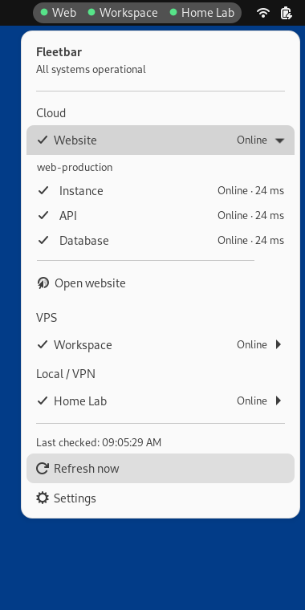
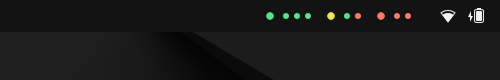
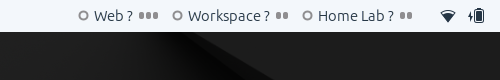
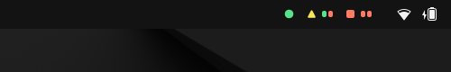
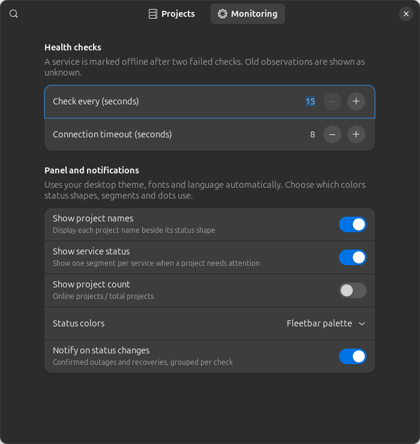
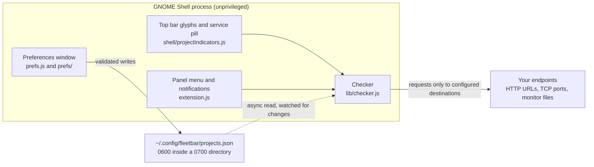
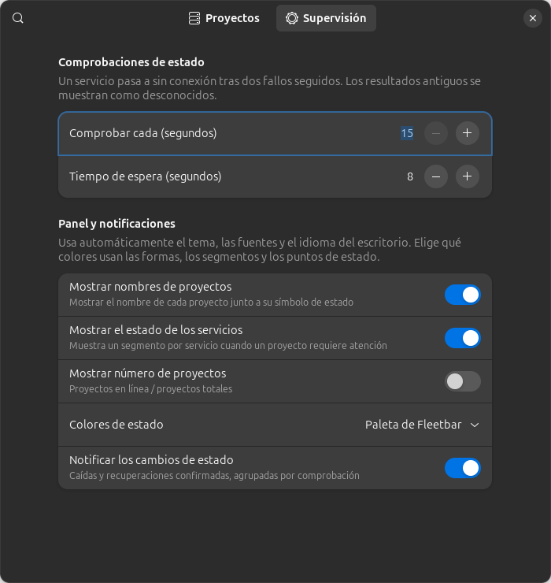

<div align="center">

# Fleetbar

**Know which projects need attention, straight from your GNOME top bar.**

<a href="https://extensions.gnome.org/extension/11330/fleetbar/"></a>
<a href="https://extensions.gnome.org/extension/11330/fleetbar/"></a>
<a href="LICENSE"></a>
<a href="docs/VALIDATION.md"></a>
<a href="#requirements"></a>
<a href="#security-and-privacy"></a>

<picture>
  <source media="(prefers-color-scheme: dark)" srcset="docs/screenshots/menu-dark.png">
  <source media="(prefers-color-scheme: light)" srcset="docs/screenshots/menu-light.png">
  
</picture>

<sub>Screenshots are native captures of the packaged extension taken in an isolated GNOME Shell 46 session, not mock-ups or design renders. See [Validation](#validation).</sub>

</div>

## Table of contents

- [Why](#why)
- [Features](#features)
- [Requirements](#requirements)
- [Installation](#installation)
- [Usage](#usage)
- [How it works](#how-it-works)
- [Security and privacy](#security-and-privacy)
- [Validation](#validation)
- [Localization](#localization)
- [Troubleshooting](#troubleshooting)
- [Development](#development)
- [Roadmap](#roadmap)
- [Contributing](#contributing)
- [License and credits](#license-and-credits)

## Why

Watching a handful of servers usually means a browser tab, a terminal, or a phone app. Most of the time the only question that matters is simpler than any dashboard: is everything OK, and if not, what failed? Your top bar already answers that question for the machine you are using, so Fleetbar answers it for your projects there too.

It is made for small, mixed estates: a website backed by an instance, an API and a database; a VPS; a home lab behind a VPN. Each becomes a project with its own services and provider group. There is no account, no agent on the servers and no telemetry: the extension asks the endpoints you configure, from your own session, and shows what it sees.

## Features

### A named glyph per project, in four honest shapes


Every project gets one glyph whose shape and colour come from its aggregate state, with the project name beside it by default. The shapes carry the meaning on their own, so the bar still reads correctly without relying on colour, and the extension exposes the same information to screen readers as accessible names.

| Glyph | State | Meaning |
| --- | --- | --- |
| ● circle | Online | every service is healthy |
| ▲ triangle | Needs attention | at least one confirmed failure, and the project is not fully down |
| ■ square | Offline | every service is confirmed down |
| ○ ring | Unknown | checking, waiting for confirmation, or out of date |

Colours come from the Fleetbar palette by default (green, amber, red, grey) or from the Shell's own semantic colours when **Settings → Status colours** is set to Theme colors. The glyphs and labels follow your desktop theme and font.

<br clear="right">

### A service pill that appears only when something needs attention



A healthy project is just its glyph, so the bar stays quiet. The moment a service fails, a pill appears beside the glyph with one segment per service, in the order the services are configured: green for up, red for down, grey while unknown or unavailable. The project label carries the story while it is not healthy: the healthy count during a failure, such as `Workspace 1/2`, and a `?` while the state is uncertain. Even with the menu closed you know whether the whole project is down or a single component.

The pill is independent of the menu. Turn it off in **Settings → Show service status** and a failure changes only the project glyph.

<br clear="right">

### The menu repeats everything, with response times

The pair of menus at the top of this README shows the pattern. Projects are grouped by provider and each one repeats the glyph and label from the top bar. Expanding a project lists its services with their state and, when there is one, the last response time in milliseconds, plus the project's shortcuts: open the website, open the project folder on disk, or start an SSH session. The footer shows when the last check ran and offers **Refresh now** and **Settings**. The menu uses GNOME's native menu widgets, follows your theme and language automatically, and closes with Escape like any other menu.

### Uncertainty stays visible



Fleetbar never turns a single missed response into an outage, and it never shows old data as if it were fresh.

- The first failed observation shows Unknown: a ring glyph and grey segments. A second consecutive failure confirms the outage.
- Recovery works the same way in reverse, and notifications fire only on confirmed transitions for projects that were already being watched.
- Results older than two check intervals plus the timeout expire to Unknown, and monitor files older than two minutes count as stale. An out of date green would be misleading, so Fleetbar draws a ring instead.

<br clear="right">

### Compact when the top bar is busy



Turn **Settings → Show project names** off and each project shrinks to its glyph and, when it matters, its service segments. The order of projects never changes, so you can still tell which one moved at a glance, and the bar stays readable with many projects even next to other extensions.

<br clear="right">

### Checks that fit what you already run

Checking is read only: Fleetbar observes, and never deploys, restarts or logs in to anything. Each service is one of three check types.

| Type | What it proves | Details |
| --- | --- | --- |
| HTTP health check | the URL answers 2xx and, optionally, that a JSON field has an exact value | TLS is verified, redirects count as failures, nested fields use dot paths such as `components.database.status`, and bodies are capped at 256 KiB |
| TCP port | something accepts a connection on the host and port | proves reachability, not application health |
| Monitor file | any local probe can publish its own state in a small JSON file | a missing, unreadable or stale file shows as Unknown; only `status` and `failures` are read |

Monitor files let a local script, timer or job report into the top bar without Fleetbar running it:

```json
{"services":{"worker":{"status":"up","failures":0}}}
```

### Settings that stay out of the way



The **Monitoring** page holds the options that affect checks and presentation; the **Projects** page is the editor for providers, projects and services. Changes apply to the running extension immediately, with nothing to restart.

| Setting | Default | What it does |
| --- | --- | --- |
| Check every | 30 s | how often services are polled, from 15 to 300 seconds |
| Connection timeout | 8 s | how long a single check may take, from 2 to 30 seconds |
| Show project names | on | the name beside each glyph; off gives the compact row |
| Show service status | on | the per-service pill during a failure |
| Show project count | off | how many projects are fully online, such as `2/3` |
| Status colours | Fleetbar palette | the Fleetbar palette or the Shell's theme colours |
| Notify on status changes | off | confirmed outages and recoveries, grouped per check |

Notifications are off by default and stay silent about uncertain states, so a single bad observation never produces a notification.

<br clear="right">

## Requirements

| | |
| --- | --- |
| Desktop | GNOME Shell 46, tested on Ubuntu 24.04 with the default Yaru theme, on Wayland and on X11 |
| Runtime | nothing extra to install: GJS, libsoup 3 and GTK 4.12+ with Libadwaita 1.4+ for the preferences ship with GNOME 46 |
| Network | outbound HTTP(S) or TCP access from your machine to the endpoints you configure; no inbound ports and no agent on the servers |
| Optional | GNOME Terminal with OpenSSH for the SSH shortcuts, and local files for monitor checks |
| Privileges | none beyond your user session; Fleetbar never asks for root |

## Installation

### From extensions.gnome.org

Fleetbar 1.2.0 was uploaded to [extensions.gnome.org](https://extensions.gnome.org/extension/11330/fleetbar/) on 2026-10-17 and is **in review**. A new listing stays hidden until it passes its first review, so the page may still answer with a 404; until then, install from source below. Reviewers are handed the exact ZIP that `npm run package -- --submission` builds.

### From source

```bash
git clone https://github.com/joseteo/fleetbar.git
cd fleetbar
./install.sh
```

`install.sh` copies the extension into `~/.local/share/gnome-shell/extensions/fleetbar@joseteo.github.com`, compiles the settings schema and the Spanish translation, and enables Fleetbar for the next Shell start. To load it now:

- **X11:** press `Alt+F2`, type `r`, press Enter.
- **Wayland:** log out and back in.

If the glyphs still do not appear, check that Fleetbar is enabled in the Extensions app.

### Import an existing configuration

The installer also accepts a configuration file. It is validated by the same code the extension uses, and only a valid file replaces the current one:

```bash
./install.sh /path/to/projects.json
```

The format is documented in [config.example.json](config.example.json).

### Uninstall

```bash
gnome-extensions uninstall fleetbar@joseteo.github.com
rm -rf ~/.config/fleetbar   # optional: the project configuration
```

## Usage

1. Open the menu and choose **Settings** (or use Extensions → Fleetbar → Settings). Add a provider, then a project, then one service per thing you want checked.
2. The top bar now shows one glyph per project. Click it for the full menu.
3. When a check fails, the project shows Unknown while the failure is confirmed, then the pill and the count. Open the menu to see which service is failing and when it was last checked.
4. Use a project's shortcuts in the menu to open its website, open its folder on disk, or start an SSH session.
5. Tune the interval, timeout, colours and notifications in **Settings → Monitoring**.

## How it works



- The Shell runs one checker per enabled extension. It walks every service each cycle, requests an endpoint shared by several services only once, and keeps at most eight checks in flight at the same time. A cycle is cancelled cleanly when a new one starts or the extension is disabled.
- Every result is per service: state, response time and timestamp. The project state is their aggregate (all up, partially failed, all failed), and the confirmation rule from [Uncertainty stays visible](#uncertainty-stays-visible) decides when a failure becomes visible.
- The configuration is read without blocking the Shell, and the file is watched for changes. Saving in the preferences window or editing the JSON by hand updates the running extension without a restart; a malformed file is reported and does not replace the working configuration.
- Blocking file access lives in a preferences-only module, so the compositor never waits on disk IO. Disabling the extension destroys its actors, timers, file monitors and signals, so re-enabling it starts from a clean slate.

## Security and privacy

| | |
| --- | --- |
| Telemetry | none: no analytics, no crash reporting, no remote configuration, no account |
| Network | health checks go only to the HTTP URLs, hosts, ports and files you configure; nothing else is contacted |
| Storage | the project configuration is `~/.config/fleetbar/projects.json`, written 0600 inside a 0700 directory; monitoring options live in GSettings |
| Read only | checks observe; they never deploy, restart or modify anything, and monitor files are only read |
| SSH | a session opens only when you choose it, in GNOME Terminal, with strict host key checking, using your existing keys and SSH configuration |
| Secrets | the format has no field for credentials; keep them out of endpoint URLs, where they would also leak into logs |

In short: Fleetbar watches your projects from your own machine, the way you would, and tells nobody. The full statement is in [PRIVACY.md](PRIVACY.md).

## Validation

Everything this README claims is exercised by tests that run the real code, and the screenshots above are written by those tests rather than assembled by hand.

- A native Shell harness boots a headless GNOME Shell 46 with throwaway XDG directories and its own session bus, installs the same runtime files the ZIP ships, and asserts what is visible: the four glyph shapes, the pill hiding while healthy and showing one segment per service, menu status dots, counts, compact mode, light and dark themes, both status colour sources, notifications, signal cleanup and re-enable, and stale results during busy checks.
- A preferences harness renders the real Libadwaita window in English and Spanish, and captures the preferences screenshots used above.
- The checker suite runs against real GJS, libsoup and Gio fixtures: shared endpoint deduplication, unhealthy responses, redirects, oversized responses, TCP, deadlines, stale monitor data and cancellation.
- Model unit tests cover presentation, segment states and ordering, typed expectations, strict matching, confirmation and recovery, expiry, and rejection of unsafe configuration.
- The built ZIP passes Shexli 0.2.1 static analysis with zero findings, and the packaging script's verifier checks its runtime inventory and private data rules.

Exact commands, the isolation wrapper for the harnesses and the latest results are recorded in [docs/VALIDATION.md](docs/VALIDATION.md).

## Localization



Fleetbar ships in English and Spanish, and follows your desktop's language, font and theme automatically (the two menus at the top of this README are the same extension in dark and light). The Spanish catalog covers all 112 user-facing strings.

Translations live in `po/`. The Spanish catalog is generated by `scripts/build-translations.py`, which fails when any user-facing string is missing an entry, so new messages cannot ship untranslated. To add a language, extend that dictionary or contribute a standard `po/<code>.po`; `install.sh` and the packaging script compile every catalog in `po/`.

<br clear="right">

## Troubleshooting

<details>
<summary>The extension does not appear in the top bar</summary>

Check that Fleetbar is enabled in the Extensions app. A fresh install only joins the Shell at the next start: `Alt+F2`, `r` on X11, or a full log out on Wayland. If it still does not show, run `journalctl -f -o cat /usr/bin/gnome-shell` while you reload and look for `fleetbar` errors.
</details>

<details>
<summary>A project is stuck on Unknown (ring glyph)</summary>

That is the honest state, not a bug: a first failed observation is confirmed on the next cycle, results expire into Unknown after two check intervals plus the timeout, and monitor files older than two minutes count as stale. If it persists, open the menu; the service rows show what happened. A timeout shorter than the endpoint's real response time is the usual cause.
</details>

<details>
<summary>An HTTP check fails although the site is fine in a browser</summary>

Fleetbar expects a 2xx response, treats redirects as failures, verifies TLS, and gives up on bodies larger than 256 KiB. Point the check at a small health endpoint rather than a full page: a login redirect or a large page will fail where a browser would silently follow along. If you use a JSON field rule, it must match exactly and the field must be present.
</details>

<details>
<summary>Notifications never arrive</summary>

They are off by default; enable **Settings → Notify on status changes**. Only confirmed outages and recoveries notify, so a single blip between checks stays silent, and a project that has not yet had a first confirmed healthy state will not produce a recovery notice.
</details>

<details>
<summary>The SSH shortcut does nothing</summary>

The shortcut uses GNOME Terminal and your own OpenSSH configuration, with strict host key checking. If the host is not in `~/.ssh/known_hosts`, the terminal opens with the failure message instead of a session. Run `ssh host` once, verify the fingerprint, and the shortcut will work from then on.
</details>

<details>
<summary>Where is my configuration stored?</summary>

Everything lives in `~/.config/fleetbar/projects.json`, written 0600 inside a 0700 directory. Files edited by hand and saves from the preferences window are both watched and reloaded. The installer validates any imported file before replacing a good configuration, and nothing in the format holds credentials, so a configuration file stays safe to back up or move between machines.
</details>

## Development

Requirements: Node 22.13+ for tests and linting, Python 3 for the checker fixtures and tooling, and GJS, `glib-compile-schemas`, gettext plus a GNOME Shell 46 session for the native harnesses.

```bash
npm ci                                  # developer dependencies (ESLint)
npm run lint                            # ESLint over extension, prefs and tests
npm test                                # model unit tests (node --test)
python3 tests/checker_integration.py    # real libsoup and Gio fixtures
python3 scripts/build-translations.py   # rebuild the Spanish catalog
glib-compile-schemas --strict schemas   # verify the GSettings schema
npm run package -- --submission         # build dist/*.zip and run the verifier
```

The native harnesses boot their own Shell and must never be run inside your live desktop session:

```bash
env XDG_DATA_HOME=/tmp/fleetbar-test/data XDG_CONFIG_HOME=/tmp/fleetbar-test/config \
    XDG_CACHE_HOME=/tmp/fleetbar-test/cache XDG_RUNTIME_DIR=/tmp/fleetbar-test/run \
    dbus-run-session -- bash tests/run-shell-smoke.sh
```

The layout:

| Path | Contents |
| --- | --- |
| `extension.js` | the Shell side: button, menu, notifications, lifecycle |
| `prefs.js`, `prefs/` | the Libadwaita preferences window |
| `lib/checker.js` | HTTP, TCP and monitor file checks |
| `lib/model.js` | project model, aggregation and state transitions |
| `lib/config.js`, `lib/configFile.js` | asynchronous reads for the Shell; validated, preferences-only writes |
| `shell/` | project glyphs, colour palettes, panel indicators |
| `schemas/` | the GSettings keys behind the Monitoring page |
| `tests/` | unit tests, checker fixtures and the two native smoke harnesses |
| `scripts/` | packaging, translation build, config import, live audit |
| `docs/` | validation notes, store listing copy, release process |

`gjs -m scripts/check-live.js` runs a read-only audit against a running session and prints the state of every configured project; it never writes.

## Roadmap

- [x] Shape-coded project glyphs with names, and the service pill
- [x] HTTP, TCP and monitor file checks with per-service detail
- [x] Confirmed outage and recovery notifications
- [x] Fleetbar and theme status colour sources
- [x] English and Spanish
- [ ] Support for GNOME Shell releases after 46, as they are tested
- [ ] More languages

## Contributing

Issues and pull requests are welcome at [joseteo/fleetbar](https://github.com/joseteo/fleetbar). Please run `npm run lint` and `npm test` before opening a pull request, and describe how you exercised the change; the isolated harness above is the expected way. The release process, including the checks run for the store submission, is documented in [docs/RELEASING.md](docs/RELEASING.md).

## License and credits

Fleetbar is free software under the [GPL-2.0-or-later](LICENSE), copyright 2026 joseteo. All screenshots show synthetic example projects, not real infrastructure. The extension is built on the public GNOME Shell extension APIs; thanks to the GNOME Shell, GJS, libsoup and Libadwaita developers and to the extension documentation at [gjs.guide](https://gjs.guide/extensions/). GNOME is a trademark of the GNOME Foundation; Fleetbar is an independent project and is not endorsed by the GNOME Project.
