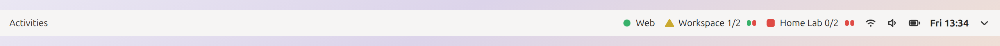
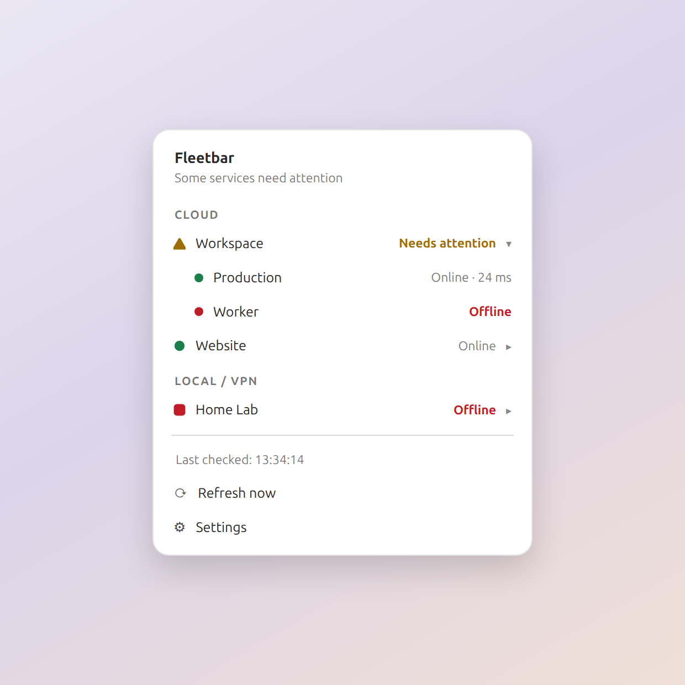

# Fleetbar

**Know which projects need attention, straight from your GNOME top bar.**

Fleetbar shows every project as a named shape-coded glyph in your GNOME top bar - green circle when healthy, amber triangle while a service needs attention, red square when offline, ring while uncertain - followed by a compact service pill that only appears when something is wrong, so a failing component is visible at a glance. Open the menu for services, response times, providers and shortcuts. Configure your own endpoints and groups in native Libadwaita settings.

<picture>
  <source media="(prefers-color-scheme: dark)" srcset="docs/images/panel-dark.png">
  
</picture>

| Indicator | Meaning |
| --- | --- |
| Green | Every service is healthy |
| Amber | Some services have confirmed failures |
| Red | Every service has a confirmed failure |
| Gray | Checking, unavailable or out of date |

Healthy projects stay calm: one shape glyph and the name. The moment a service fails, a pill of small segments appears beside the project - one segment per service, in the configured order - the failing segment in red (gray while unknown), and the project glyph switching to a triangle or square. The menu repeats every project as the same shape glyph and lists each service as a colored dot with response times. Labels show healthy service counts during failures (`API 2/3`) and `?` when status is uncertain. Names, menu text and screen reader descriptions accompany the shapes and colors. Set a short top bar label for any project, turn names off for a compact row of glyphs, hide the service pill in Settings, or let status colors follow your theme instead of the Fleetbar palette.

<picture>
  <source media="(prefers-color-scheme: dark)" srcset="docs/images/states-dark.png">
  
</picture>

<picture>
  <source media="(prefers-color-scheme: dark)" srcset="docs/images/menu-dark.png">
  
</picture>

## Features

- Providers and projects grouped in one native panel menu.
- Shape-coded project glyphs plus a per-service pill that appears when a check fails, so a failing component is visible without opening the menu.
- HTTP health checks with exact JSON field matching, TCP connectivity checks, and optional local monitor files.
- Shared HTTP endpoints are polled once per cycle. At most eight service checks run concurrently.
- Configurable refresh interval and connection timeout. Two failed checks confirm an outage; stale data never counts as healthy.
- Optional grouped outage and recovery notifications.
- Shortcuts for websites, local folders and interactive SSH connections.
- System fonts and theme, a choice between the Fleetbar palette and theme-derived status colors, light and dark support, English and Spanish translations.
- No telemetry, remote account or monitoring subscription.

## Compatibility

GNOME Shell **46**. GTK 4.12+ / Libadwaita 1.4+ and libsoup 3 are required. This is tested on Ubuntu 24.04 with Yaru. Other Shell versions are not claimed until tested. SSH shortcuts currently require GNOME Terminal and OpenSSH; monitoring works without them.

## Install from source

```sh
./install.sh
```

On X11, use Alt+F2, type `r`, and press Enter after installation or JavaScript updates. On Wayland, log out and back in. Enable **Fleetbar** in GNOME Extensions if necessary.

Open Fleetbar → Settings → **+** to add a project, its provider and services. Optional top bar labels keep long names compact. Monitoring settings control polling, timeouts, project labels, the service status pill, the status color source, aggregate count and notifications.

To import an existing configuration:

```sh
./install.sh /path/to/projects.json
```

See [config.example.json](config.example.json) for the format. The earlier local prototype is migrated with `gjs -m scripts/migrate-settings.js` after installing Fleetbar. The migration preserves the old configuration as a backup.

## Check behavior

**HTTP:** a direct 2xx response is required. Optional field rules match scalar values exactly. Nested fields use dot paths, such as `components.database.status`. An HTTP 200 containing an unhealthy value fails. Redirects fail, TLS certificates are verified normally, and responses are capped at 256 KiB. Use small, read-only health endpoints.

**TCP:** an open port proves connectivity to the instance; it does not prove that the application or database is healthy. No login or commands are involved.

**Local monitor:** read a compatible monitor state file of the following shape. Unknown probes, unreadable files, and files older than 120 seconds yield Unknown. In particular, the existing local monitor can be reused without accessing its credentials or rerunning inference.

```json
{"services":{"worker":{"status":"up","failures":0}}}
```

A project is online only when all of its checks are healthy. The first failed observation shows Unknown while confirming. Mixed healthy/failed services show Needs attention; all failed services show Offline. Each pill segment follows its own check, so the failing component is identifiable in the top bar and repeated with names in the menu. Expired results become Unknown after two refresh intervals plus the timeout. Notifications start after a previously observed healthy/unhealthy state and are off by default.

## Privacy and security

The extension sends GET requests and TCP connections only to destinations you configure. Project data stays in `~/.config/fleetbar/projects.json`, created with private permissions. Monitoring preferences use GSettings. No analytics, telemetry, remote configuration or credentials are bundled. Avoid putting secrets in endpoint URLs.

Project checks do not deploy, restart or modify servers. SSH is launched only when selected, using direct arguments and existing SSH configuration, with trusted host key verification. A malformed configuration is reported without replacing it. See [PRIVACY.md](PRIVACY.md).

## Development

Development checks require Node.js 22.13+ and GNU gettext. Node.js is not needed to run the extension.

```sh
npm ci
npm run lint
npm test
python3 tests/checker_integration.py
python3 scripts/build-translations.py
glib-compile-schemas --strict schemas
```

`gjs -m scripts/check-live.js` performs read-only checks using the local private configuration. `tests/run-shell-smoke.sh` and `tests/preferences-smoke.js` run native UI tests in an isolated desktop; they must not run inside your normal Shell session. The example screenshot/test projects are synthetic and contain no production infrastructure data.

```sh
./scripts/package.sh
```

This creates a runtime-only ZIP in `dist/` and verifies its contents. Development tooling, tests and private configuration are excluded. [docs/RELEASING.md](docs/RELEASING.md) records the submission process, supported version and remaining publication requirements. [docs/STORE_LISTING.md](docs/STORE_LISTING.md) contains listing copy.

## License

GPL-2.0-or-later. See [LICENSE](LICENSE).
